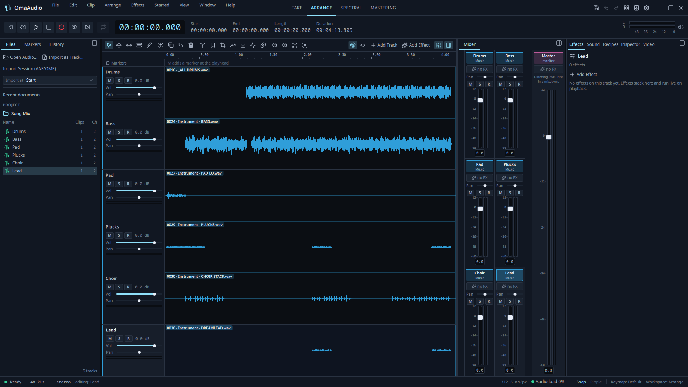

# OmaAudio

Record, edit, mix and clean up audio on Linux. Work on a single recording or
arrange many tracks, add effects, repair noise and clicks, check loudness and
export a finished file — made for [Omarchy](https://omarchy.org), and an
ordinary desktop application on any Arch Linux system with PipeWire.



> **Beta.** OmaAudio is ready to be used and tried, and still being finished.
> It never changes the audio files you bring in — it works on its own copy — but
> keep backups of anything important, and please
> [report anything that doesn't behave as you'd expect](https://github.com/28allday/omaaudio/issues).
> [Known limitations](#known-limitations) lists what isn't finished yet.

**The complete user guide is [docs/user-manual.md](docs/user-manual.md)** — step
by step, with every shortcut, troubleshooting and a plain-language glossary. The
same guide opens inside the app from **Help › User Manual**.

## What you get

- **Four pages for four jobs.** *Take* edits one recording sample by sample;
  *Arrange* lays out tracks and clips; *Spectral* shows sound as a picture so
  you can paint out a cough, a click or a hum; *Mastering* finishes and exports
  the whole mix.
- **Editing that keeps its place.** Cut, copy, paste, trim, split, fade and
  crossfade, with ripple or gap-keeping edits, unlimited Undo and a History you
  can step back through. Drag a clip's edges to trim it, its corner handles to
  fade it and its level line to change its volume.
- **Tracks and a mixer.** Volume, pan, mute, solo, track roles and colours,
  routing to buses with sends, automation you can draw or record, and a mixer
  with meters.
- **Effects.** Use the LV2, CLAP and VST3 effects installed on your system on
  any track, on single clips or on the final mix. Each effect opens in its own
  panel with knobs or sliders, live meters, an EQ curve where it fits, and
  starting-point presets for common jobs such as a podcast voice or a
  broadcast limit. OmaAudio comes with the Calf, LSP and x42 effects, and a
  few of its own: Low Cut, Hum Removal, Voice Cleanup, Width, Limit Peaks and
  Change Level.
- **Quick Fixes and the Sound panel.** Say what a track is — voice, music,
  effects or ambience — and turn on the fixes that suit it: even out speech,
  reduce noise and hum, de-ess, brighten, duck music under a voice.
- **Repair.** Voice Cleanup removes background noise from speech with a small
  speech-trained model that runs on your computer. The Spectral page reduces
  steady noise, heals clicks and coughs, restores clipped peaks and reduces
  late reverb.
- **Tidy pauses and recipes.** Shorten long gaps in speech in one step, and
  save a chain of fixes as a recipe to run on other recordings.
- **Recording.** Record mono or stereo through PipeWire, with punch-in,
  count-in, loop takes and several inputs at once. A new take goes on a track
  just under the one you are working on.
- **Loudness and delivery.** Measure to EBU R128, set a track or the whole mix
  to a target, and export to WAV, BWF, RF64, AIFF, FLAC, Ogg Vorbis, Opus, MP3
  or AAC/M4A — the whole project, a time selection, or each track as its own
  file — with delivery presets for podcasts, streaming and broadcast.
- **Work with picture.** Open a video beside your project and it plays in time
  with the audio, with its timecode.
- **Bring in work from video editors.** Import an AAF (for example DaVinci
  Resolve's export) or an OMF session as tracks and clips, with their fades,
  clip levels and timecode. The timeline's picture comes in too, as the
  project's reference video.
- **Agent command line.** Everything can also be done without a window by an AI
  agent or a script: `omaaudio cli`. See [the agent guide](docs/agent-cli.md).
- **Help where you need it.** Hover over any control for what it does; press F1
  for more.

## Install

Download the package from the
[latest release](https://github.com/28allday/omaaudio/releases), then install
the file you downloaded:

```bash
sudo pacman -U ~/Downloads/omaaudio-0.2.0beta1-1-x86_64.pkg.tar.zst
```

(The package is unsigned, so pacman won't install it straight from a web
address — download it first, then install the local file.)

Or build it yourself:

```bash
git clone https://github.com/28allday/omaaudio.git
cd omaaudio/pkgbuild
makepkg -si
```

OmaAudio then appears in your app launcher, and `omaaudio` runs it from a
terminal (`omaaudio song.wav` opens a file straight away).

### Optional extras

```bash
sudo pacman -S --needed pipewire-jack  # connect JACK applications
sudo pacman -S --needed xorg-xwayland  # open effects in their own windows
```

The Calf, LSP and x42 effects come with the package, and so does FFmpeg: it reads AAC, M4A and the MXF audio in AAF exports, and plays and builds the reference video.

### On Omarchy: make the window opaque

Omarchy gives every window a touch of transparency, which isn't right for an
audio editor — a waveform should be read against its own background. Add one
line to `~/.config/hypr/hyprland.lua`:

```lua
o.window("^(omaaudio)$", { opacity = "1 1" })
```

## First steps

1. Open a recording with **File › Open Audio…** (or drag it onto the window).
2. Drag across the waveform to select, then cut, fade or adjust it; **Space**
   plays and stops.
3. Switch to **Arrange** to add more tracks, or **Mastering** to finish the mix.
4. **File › Export Audio…** writes the finished file. **File › Save** keeps the whole
   project, with its audio, so you can come back to it.

The [user guide's first edit](docs/user-manual.md#your-first-edit) walks
through this in more detail.

## Use it with an AI agent

`omaaudio cli` gives agents and scripts the same editing, mixing, effects,
analysis and export as the app, with no window. `omaaudio cli --help` explains
it; [docs/agent-cli.md](docs/agent-cli.md) is the full guide. An agent skill
comes with the package — run this once as your own user, then start a new agent
session:

```bash
omaaudio skill --link
```

## Where OmaAudio keeps things

- **Your projects** go wherever you save them, as `.omaaudio` folders holding
  their own copy of the audio (and of the reference video).
- **Settings and keyboard shortcuts:** `~/.config/omaaudio/`
  (`omaaudio.conf`, `keymap.toml` — edit shortcuts there).
- **Recovery copies, unsaved recordings and built pictures:**
  `~/.local/state/omaaudio/` — kept until you save or discard them.
- **Caches:** `~/.cache/omaaudio/` — safe to delete; rebuilt when needed.

**Edit › Preferences… › More** shows the exact locations on your machine.

## Uninstall

```bash
omaaudio skill --unlink    # only if you linked the agent skill
sudo pacman -R omaaudio
```

Your settings and recovery files stay in the folders above; delete them too if
you want nothing left behind. Your saved projects are never touched.

## Requirements

Arch Linux (or Omarchy) with PipeWire, on x86_64 (aarch64 builds from source).
Everything else it needs — Qt 6.8 or later, libsndfile, lilv, rnnoise, Python 3
and the rest — is installed automatically with the package.

## Troubleshooting

**I can't hear anything.** Check the master level and that no track is soloed;
**Window › Audio Setup** shows what PipeWire sees. The
[user guide](docs/user-manual.md#troubleshooting) has more.

**The window is slightly see-through on Omarchy.** That's Omarchy's default
window transparency — add the one-line rule from
[Install](#on-omarchy-make-the-window-opaque).

**An effect is greyed out in the effect browser.** The row says why — usually a
feature the effect needs that OmaAudio doesn't provide yet, or a channel layout
that doesn't fit the track.

**The status bar says "Save queued".** Another job is finishing; the save has
been accepted and starts by itself.

**A project won't open.** OmaAudio refuses a project rather than half-reading
it, and says why. A project from a newer version, or a damaged `session.toml`,
won't open — your audio is still in the project's `audio` folder, and you can
import it into a new project.

## Known limitations

This is a beta. What isn't finished yet:

- **VST3 and CLAP effects** work, with their own windows and presets, but have
  only been tried with test effects so far — tell us how real ones behave.
- **OMF import** brings in audio only, not picture, and has not yet been tried
  with real OMF exports.
- **AAF picture:** dissolves between shots become cuts, and video effects show
  their source shot. A picture built from an edited timeline stays in
  `~/.local/state/omaaudio/pictures/` if you undo the import, until you delete it.
- **One tempo and meter per project** — tempo changes within a project aren't
  supported.
- **Intel graphics** hasn't been tested yet. OmaAudio falls back to software
  drawing if the graphics driver fails.
- Effect windows open through X11 (XWayland on a Wayland desktop); without it,
  OmaAudio's own controls for the effect are still there.

## Look

OmaAudio keeps a fixed dark look so a waveform, a meter and a spectrogram read
the same on every machine and under every theme. Its accent colour follows your
Omarchy theme and changes with it while the app is open. Your desktop's text
size is respected.

## Credits and licence

OmaAudio is © 2026 Gavin Nugent, released under the [MIT licence](LICENSE).

It is built with Qt, PipeWire, libsndfile, lilv and the LV2 libraries, RNNoise,
Signalsmith Stretch, the CLAP and VST 3 SDK headers, pyaaf2 and Lucide icons,
among others. Every component keeps its own licence — see
[Credits and licences](docs/third-party-notices.md) for the full list, and
[docs/licenses](docs/licenses/) for their licence texts (installed in
`/usr/share/licenses/omaaudio/`). Effects you install keep their own licences.

OmaAudio is not affiliated with, derived from, or endorsed by Audacity, Tenacity,
Ardour, Adobe, or the Omarchy project.
